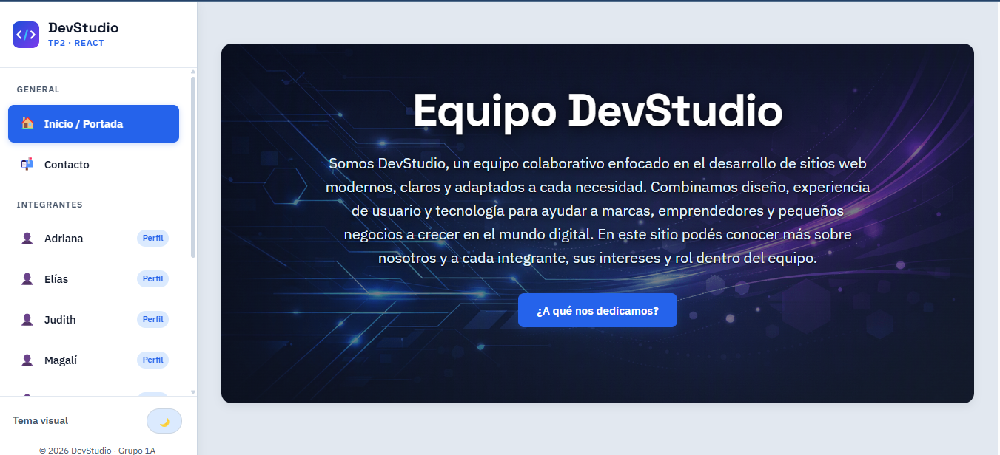
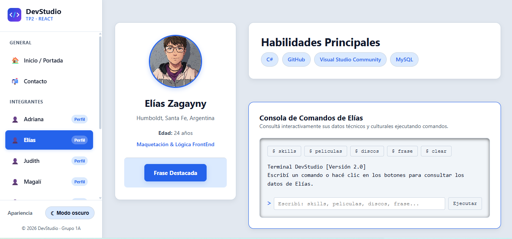
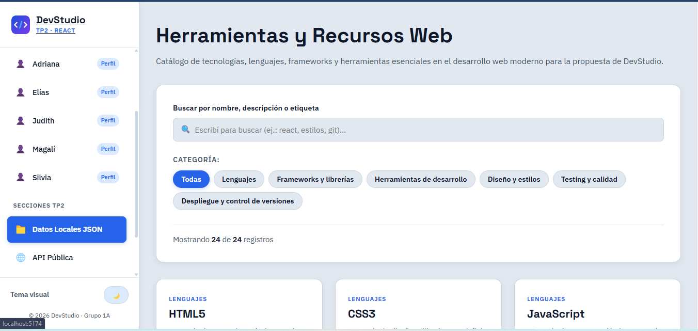
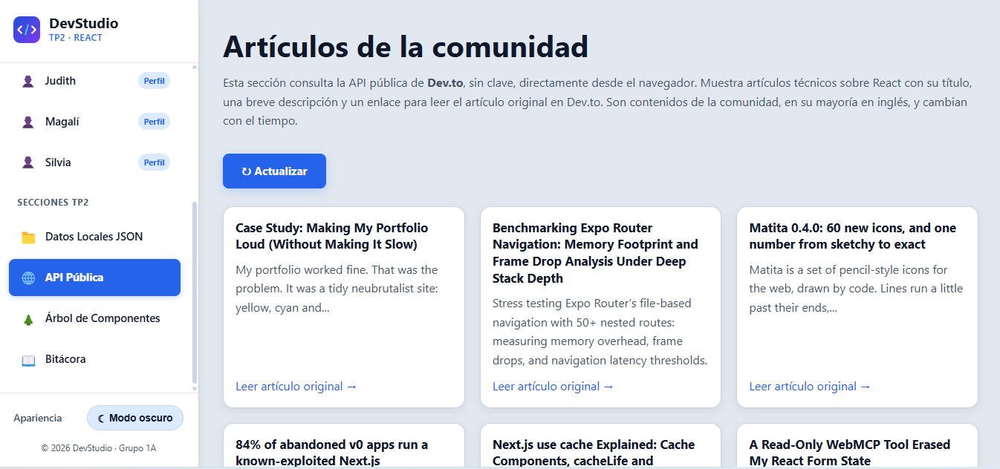

# TP2 · Proyecto React en Equipo — DevStudio

Trabajo Práctico Grupal 2 de la materia **Desarrollo de Sistemas Web (Front End)**, correspondiente al segundo cuatrimestre de 2026 de la Tecnicatura Superior en Desarrollo de Software del IFTS N.° 29.

DevStudio continúa el proyecto grupal iniciado en el TP1 y lo transforma en una aplicación desarrollada con React. La propuesta presenta al equipo, sus perfiles, contenidos culturales y recursos tecnológicos mediante una navegación interna compartida, componentes reutilizables, datos locales en JSON, consumo de una API pública e interacciones personalizadas.

## Índice

- [Enlaces del proyecto](#enlaces-del-proyecto)
- [Integrantes](#integrantes)
- [Características principales](#características-principales)
- [Capturas de la aplicación](#capturas-de-la-aplicación)
- [Tecnologías utilizadas](#tecnologías-utilizadas)
- [Instalación y ejecución local](#instalación-y-ejecución-local)
- [Scripts disponibles](#scripts-disponibles)
- [Secciones y navegación](#secciones-y-navegación)
- [Arquitectura y organización](#arquitectura-y-organización)
- [Datos locales y API pública](#datos-locales-y-api-pública)
- [Interacciones de los perfiles](#interacciones-de-los-perfiles)
- [Diseño y accesibilidad](#diseño-y-accesibilidad)
- [Evolución desde TP1](#evolución-desde-tp1)
- [Uso de inteligencia artificial](#uso-de-inteligencia-artificial)

## Enlaces del proyecto

- **Aplicación publicada en Vercel:** (https://tp2-frontend-grupo1a.vercel.app)
- **Repositorio público en GitHub:** (https://github.com/sil-graci/tp2-frontend-grupo1a)

## Integrantes

| Integrante | Responsabilidad principal | Perfil de GitHub |
|------------|--------------------------|------------------|
| Adriana Meyniel | Portada del equipo, perfiles individuales, gestión de datos de integrantes e integración de interacciones personalizadas. | [@Adrilu-web](https://github.com/Adrilu-web) |
| Silvia | Navegación, layout compartido, rutas de React Router, sidebar y soporte de publicación de la aplicación. | [@sil-graci](https://github.com/sil-graci) |
| Magalí | Catálogo tecnológico, gestión de datos JSON, búsqueda, filtros y visualización dinámica de registros. | [@pintosmagali](https://github.com/pintosmagali) |
| Judith | Integración de API pública, gestión de estados de carga y error, y componentes asociados a la consulta externa. | [@judith91](https://github.com/judith91) |
| Elías | Identidad visual, configuración del tema, árbol de componentes, bitácora y documentación del proyecto. | [@ZagaynyElias](https://github.com/ZagaynyElias) |


El proyecto conserva el mismo equipo del TP1. Cada integrante cuenta con un perfil dentro de la aplicación React y una interacción vinculada con su contenido.

## Características principales

- Aplicación de una sola página desarrollada con **React** y **Vite**.
- Navegación interna mediante **React Router DOM**.
- Sidebar compartida como estructura principal de navegación.
- Portada del equipo con acceso a los perfiles individuales.
- Perfil dinámico para cada integrante.
- Interacción funcional diferente en cada perfil.
- Catálogo tecnológico cargado desde un archivo JSON local.
- Búsqueda por texto y filtrado de tecnologías.
- Consumo de una API pública con estados de carga y error.
- Árbol de componentes que representa la jerarquía real de la aplicación.
- Bitácora del proceso grupal.
- Tema claro y oscuro administrado mediante contexto y un hook personalizado.
- Página de contacto y página de ruta no encontrada.
- Diseño responsive para escritorio, tablet y dispositivos móviles.

## Capturas de la aplicación

### Portada de DevStudio



Vista principal de la aplicación con la presentación del equipo, identidad visual y acceso a los perfiles.

### Perfil de integrante



Perfil individual desarrollado en React con interacción personalizada.

### Catálogo tecnológico



Listado dinámico generado desde JSON local con funcionalidades de búsqueda y filtrado.

### API pública



Consulta de artículos de React obtenidos desde la API pública de DEV Community.

## Tecnologías utilizadas

Las dependencias y herramientas declaradas por el proyecto son:

- **React 19** para la construcción de componentes e interfaces.
- **React DOM 19** para el renderizado de la aplicación en el navegador.
- **React Router DOM 7** para la navegación entre páginas y perfiles.
- **Vite 8** como entorno de desarrollo y herramienta de compilación.
- **JavaScript con JSX** para la lógica y la estructura de los componentes.
- **CSS modularizado por responsabilidad** para variables, estructura, componentes, sidebar y estilos generales.
- **Oxlint** para el análisis estático del código.
- **JSON local** para el catálogo de tecnologías.
- **Fetch API**, encapsulada en un hook personalizado, para consultar datos externos.
- **Vercel** para la publicación de la aplicación.
- **Git y GitHub** para control de versiones y trabajo colaborativo.

## Instalación y ejecución local

### Requisitos previos

Se necesita una versión de Node.js compatible con las dependencias declaradas por el proyecto y npm como gestor de paquetes.

### Pasos

1. Clonar el repositorio:

```bash
git clone https://github.com/sil-graci/tp2-frontend-grupo1a.git
```

2. Ingresar en la carpeta del proyecto:

```bash
cd tp2-frontend-grupo1a
```

3. Instalar las dependencias:

```bash
npm install
```

4. Iniciar el servidor de desarrollo:

```bash
npm run dev
```

5. Abrir en el navegador la dirección local informada por Vite.

## Scripts disponibles

```bash
npm run dev
```

Inicia el servidor de desarrollo de Vite.

```bash
npm run build
```

Genera la versión optimizada para producción.

```bash
npm run preview
```

Permite revisar localmente la compilación de producción.

```bash
npm run lint
```

Ejecuta Oxlint para analizar el código fuente.

## Secciones y navegación

La aplicación organiza sus contenidos mediante páginas React accesibles desde la navegación interna:

- **Inicio:** presentación general de DevStudio y acceso al equipo.
- **Perfil:** página dinámica que muestra los datos de cada integrante.
- **Catálogo:** selección de tecnologías, lenguajes, frameworks y herramientas esenciales para el desarrollo web moderno.
- **API:** sección destinada a la consulta y presentación de información obtenida desde una API pública.
- **Árbol de componentes:** representación jerárquica de los componentes de la aplicación.
- **Bitácora:** registro de decisiones, avances y dificultades resueltas durante el desarrollo.
- **Contacto:** canales y formulario de contacto del equipo.
- **Página no encontrada:** respuesta interna para rutas que no existen.

La sidebar funciona como referencia permanente entre secciones, identifica la ubicación actual y evita depender del botón Atrás del navegador.

## Arquitectura y organización

La estructura visible del proyecto se organiza de la siguiente manera:

```text
tp2-frontend-grupo1a/
├── public/
│   ├── img/
│   ├── favicon.svg
│   └── icons.svg
├── src/
│   ├── components/
│   │   ├── api/
│   │   ├── catalog/
│   │   ├── common/
│   │   ├── home/
│   │   ├── layout/
│   │   ├── profile/
│   │   └── tree/
│   ├── context/
│   │   ├── ThemeContext.js
│   │   └── ThemeProvider.jsx
│   ├── data/
│   │   ├── bitacoraData.js
│   │   ├── catalogo.json
│   │   ├── componentTreeData.js
│   │   └── teamData.js
│   ├── hooks/
│   │   ├── useFetchApi.js
│   │   └── useTheme.js
│   ├── pages/
│   │   ├── ApiPage.jsx
│   │   ├── BitacoraPage.jsx
│   │   ├── CatalogPage.jsx
│   │   ├── ContactPage.jsx
│   │   ├── HomePage.jsx
│   │   ├── NotFoundPage.jsx
│   │   ├── ProfilePage.jsx
│   │   └── TreePage.jsx
│   ├── styles/
│   │   ├── components.css
│   │   ├── layout.css
│   │   ├── main.css
│   │   ├── sidebar.css
│   │   └── variables.css
│   ├── App.jsx
│   └── main.jsx
├── .gitignore
├── .oxlintrc.json
├── index.html
├── package.json
├── package-lock.json
├── vercel.json
├── vite-config.js
└── README.md
```

### Criterios de organización

- `pages/` contiene las pantallas vinculadas con la navegación.
- `components/` reúne elementos reutilizables y las interacciones de los perfiles.
- `data/` centraliza la información local del equipo, el catálogo, la bitácora y el árbol de componentes.
- `context/` administra el estado global del tema visual.
- `hooks/` encapsula lógica reutilizable para el tema y las consultas a la API.
- `styles/` separa variables, estilos generales, layout, componentes y sidebar.

## Datos locales y API pública

### Catálogo local

El archivo `src/data/catalogo.json` contiene los registros del catálogo tecnológico. La información se muestra dinámicamente en tarjetas o listados desde `CatalogPage.jsx`.

La sección incorpora:

- búsqueda por texto;
- filtrado mediante propiedades de los registros;
- actualización inmediata de resultados;
- mensaje cuando no se encuentran coincidencias;
- opción para recuperar la lista completa.

### API pública

La aplicación consume la API pública de **DEV Community (Dev.to)**, una plataforma orientada a la publicación de contenidos técnicos para desarrolladores.

La consulta se realiza desde `ApiPage.jsx` mediante el hook personalizado `useFetchApi.js` y utiliza el siguiente endpoint:

```js
https://dev.to/api/articles?tag=react&per_page=9
```

Este endpoint recupera hasta nueve artículos relacionados con React. La información se presenta mediante el componente reutilizable `ArticleCard.jsx` e incluye:

- título del artículo;
- autor;
- fecha de publicación;
- tiempo estimado de lectura;
- etiquetas;
- imagen de portada, cuando está disponible;
- enlace al artículo original.

La interfaz también contempla:

- estado de carga mediante `LoadingSpinner`;
- mensaje de error mediante `ErrorAlert`;
- botón para actualizar o reintentar la consulta;
- mensaje específico cuando la API responde correctamente, pero no hay artículos para mostrar;
- apertura de los artículos originales en una pestaña nueva.

## Interacciones de los perfiles

Cada perfil incluye una interacción propia desarrollada con estado local mediante `useState`.

### Adriana

**Explorador y recomendador multimedia:** permite alternar entre todas las obras, películas y discos. También selecciona una recomendación aleatoria dentro de la categoría activa.

### Elías

**Consola de comandos:** permite consultar habilidades, películas, discos y una frase destacada mediante botones o comandos escritos. También incluye ayuda, limpieza de consola y respuesta ante comandos no reconocidos.

### Judith

**Gestor de favoritos:** permite marcar o desmarcar obras, consultar la selección personalizada y filtrar para mostrar únicamente los elementos elegidos como favoritos.

### Magalí

**Buscador y ordenamiento de obras:** permite buscar por título o autor, ordenar alfabéticamente en forma ascendente o descendente, conservar el orden original, limpiar la búsqueda y mostrar un estado sin resultados.

### Silvia

**Carrusel de obras favoritas:** permite recorrer secuencialmente películas y discos mediante botones anterior y siguiente, indicador de posición y selectores directos para cada obra.

### Interacción compartida

El componente `QuoteReveal.jsx` permite mostrar u ocultar una frase destacada mediante un botón accesible que comunica su estado con `aria-expanded`.

## Diseño y accesibilidad

La identidad visual de DevStudio se mantiene de forma consistente entre la portada, la sidebar, los perfiles y las secciones complementarias.

Entre las decisiones aplicadas se incluyen:

- variables CSS centralizadas en `variables.css`;
- estilos separados por responsabilidad;
- tema claro y oscuro;
- composición responsive;
- controles con textos y estados visibles;
- etiquetas ARIA en botones, campos y zonas interactivas;
- navegación interna completa;
- mensajes para estados vacíos y errores;
- componentes reutilizados con diferentes contenidos mediante props.

## Evolución desde TP1

El TP2 conserva la identidad y los contenidos generales de DevStudio, pero reorganiza la propuesta como una aplicación React.

Los principales cambios son:

- migración desde páginas HTML independientes hacia componentes y páginas React;
- navegación administrada con React Router;
- sidebar compartida entre secciones;
- perfiles integrados dentro de la misma aplicación;
- datos del equipo centralizados en módulos JavaScript;
- catálogo cargado desde JSON local;
- integración de una API pública;
- hooks personalizados para lógica reutilizable;
- contexto global para el tema visual;
- interacciones específicas para todos los perfiles;
- árbol de renderizado y bitácora incorporados como secciones navegables.

## Uso de inteligencia artificial

La inteligencia artificial se utilizó como herramienta de apoyo durante la planificación, el diseño, la programación, la revisión, la depuración y la documentación del proyecto. Las propuestas obtenidas fueron revisadas y adaptadas por el equipo antes de incorporarse a la aplicación.

### Adriana Meyniel

- **Aplicaciones utilizadas:** Microsoft Copilot y Google Gemini.
- **Modelos utilizados:** GPT, a través de Microsoft Copilot, y Gemini.
- **Usos principales:**
  - análisis de la consigna y la rúbrica;
  - asistencia en la estructura del proyecto React;
  - revisión de rutas, componentes y hooks;
  - apoyo en la interacción de recomendación multimedia;
  - depuración de código y estilos;
  - organización y redacción del README;
  - revisión técnica general del proyecto.

### Silvia

- **Aplicación utilizada:** AntiGravity.
- **Modelo utilizado:** Pendiente de informar.
- **Usos principales:** Pendiente de informar.

### Elías

- **Aplicación utilizada:** Google Gémini, ChayGPT y Codex (integrado en el IDE).
- **Modelo utilizado:** GPT.
- **Usos principales:** Pendiente de informar.

### Judith

- **Aplicación utilizada:** Pendiente de informar.
- **Modelo utilizado:** Pendiente de informar.
- **Usos principales:** Pendiente de informar.

### Magalí

- **Aplicación utilizada:** Pendiente de informar.
- **Modelo utilizado:** Pendiente de informar.
- **Usos principales:** Pendiente de informar.

### Criterio de autoría

El equipo tomó las decisiones finales sobre la arquitectura, el contenido, la navegación, las interacciones y la identidad visual. La inteligencia artificial se empleó como herramienta de apoyo y no como sustituto del trabajo de análisis, implementación, revisión y validación realizado por los integrantes.

---

Desarrollado por el **Grupo 1A** para la materia **Desarrollo de Sistemas Web (Front End)**.
